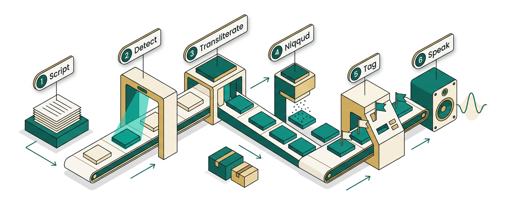
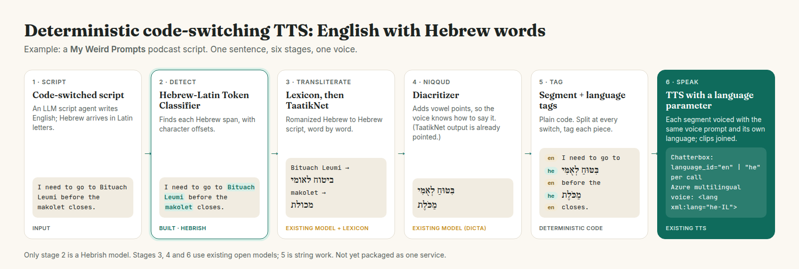
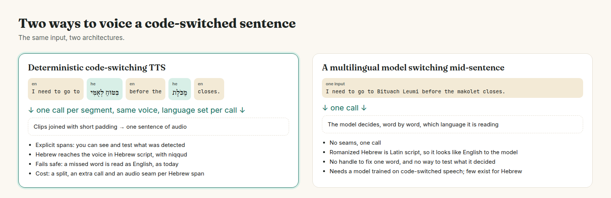

# English-Hebrew Code-Switching TTS Pipeline



How to make text-to-speech say the Hebrew words in an English script **as Hebrew**, with one
voice, by chaining small existing components. This repository is the reference for the whole
stack: what each stage does, which model does it, how the stages hand data to each other, and
working code for everything before the TTS call.

**White paper (PDF):** [`whitepaper/code-switching-tts-pipeline.pdf`](whitepaper/code-switching-tts-pipeline.pdf),
also at <https://hebrish.app/whitepaper/code-switching-tts-pipeline.pdf>.

> **Status (2026-10-20): a documented pipeline, not a packaged service.** Stages 2 to 5 run
> end to end on CPU (`pipeline/text_stages.py`; outputs in [`examples/`](examples/)). The TTS stage
> is written against the Chatterbox source but has not been run. Nobody has packaged it as one
> service yet. **You are welcome to:** wrap it in a container, put it on Replicate, Hugging Face
> or anywhere else, and share it. Tell us and we will link it.

## The example: a podcast script

[My Weird Prompts](https://myweirdprompts.com) is an AI-generated podcast produced in Jerusalem.
An LLM writes each episode's script in English. When an episode is about life in Israel, Hebrew
terms arrive in Latin letters, so **the script itself is code-switched**:

```
I need to go to Bituach Leumi before the makolet closes.
```

An English voice reads *makolet* as "MACK-oh-let". Words English already knows (*Shabbat*,
*kosher*) come out fine; the long tail of Israeli life does not.

## The pipeline



| # | Stage | Component | Licence | Status |
| --- | --- | --- | --- | --- |
| 1 | Script | Any LLM writing English with romanized Hebrew | | Input |
| 2 | **Detect** Hebrew spans | [`Hebrish/Hebrew-Latin-Token-Classifier`](https://huggingface.co/Hebrish/Hebrew-Latin-Token-Classifier) (xlm-roberta-base, BIO tags) | MIT | Built by Hebrish; run here |
| 3 | **Transliterate** to Hebrew script | A curated lexicon first, then [`malper/taatiknet`](https://huggingface.co/malper/taatiknet) per word | TaatikNet weights: none stated; its data CC-BY-SA 3.0 | Existing; run here |
| 4 | **Niqqud** (vowel points) | [`dicta-il/dictabert-large-char-menaked`](https://huggingface.co/dicta-il/dictabert-large-char-menaked), for unpointed lexicon forms | CC-BY-4.0 | Existing; run here |
| 5 | **Tag**: segment + language | Plain code: split at every switch, one `(text, lang)` per piece | | Run here |
| 6 | **Speak** | [Chatterbox Multilingual](https://github.com/resemble-ai/chatterbox), `language_id` per call; or an Azure multilingual voice with SSML `<lang xml:lang="he-IL">` | MIT (Chatterbox) | Written, **not run** |

Only stage 2 is a Hebrish model. Details, alternatives and the traps we hit:
[`docs/pipeline.md`](docs/pipeline.md).

## Run it

```bash
# Stages 2-5: text in, segments out (CPU is fine; first run downloads about 3.5 GB of models)
uv run --with torch --with "transformers<5" --with sentencepiece \
  python pipeline/text_stages.py "I need to go to Bituach Leumi before the makolet closes."

# Stage 6, Chatterbox (GPU recommended; not yet run by us)
uv run --with chatterbox-tts --with torchaudio \
  python pipeline/speak_chatterbox.py examples/bituach-leumi.json ref.wav out.wav

# Stage 6, Azure: print the SSML document
python pipeline/ssml_azure.py examples/bituach-leumi.json
```

`transformers<5` matters: transformers 5.x loads DICTA's character tokenizer as word-level and
stage 4 then silently returns the input unpointed.

## What comes out (real output, 2026-10-20)

| Sentence | Span | Detector score | Stage 3 source | Stages 3-4 output |
| --- | --- | --- | --- | --- |
| I need to go to Bituach Leumi before the makolet closes. | `Bituach Leumi` | 0.998 | lexicon | בִּטּוּחַ לְאֻמִּי |
| | `makolet` | 0.999 | lexicon | מַכֹּלֶת |
| My savta says the arnona went up again, so I called the iriya. | `savta` | 1.0 | taatiknet | סַוְטָה ✗ (should be סַבְתָּא) |
| | `arnona` | 0.996 | lexicon | אַרְנוֹנָה |
| | `iriya` | 0.998 | taatiknet | אִירִיָּה ✗ (should start with ע) |
| We spent Shabbat with the mishpacha and the kids ate bamba all afternoon. | `mishpacha` | 0.998 | taatiknet | מִשְׁפָּחָה |
| | `bamba` | 0.993 | taatiknet | בַּמְבָּה |

*Shabbat* is not flagged, by design: English already says it. The two TaatikNet errors are why
the lexicon comes first: it guesses spellings word by word with no context. Add `savta` and
`iriya` to the lexicon and both are fixed. Full JSON per sentence: [`examples/`](examples/).

## The contract between stages

Every stage reads and extends one JSON object, so any stage can be swapped:

```json
{
  "text": "I need to go to Bituach Leumi before the makolet closes.",
  "spans": [{"start": 16, "end": 29, "surface": "Bituach Leumi", "score": 0.998,
             "hebrew": "ביטוח לאומי", "source": "lexicon", "pointed": "בִּטּוּחַ לְאֻמִּי"}],
  "segments": [{"text": "I need to go to ", "lang": "en"}, {"text": "בִּטּוּחַ לְאֻמִּי", "lang": "he"}]
}
```

## Deterministic, versus a model that switches by itself



This design makes every language switch explicit: you can see what was detected, test it, and
fix one word. The alternative is a single multilingual TTS model trusted to switch languages
mid-sentence on its own. To such a model romanized Hebrew is Latin script and looks like
English, and nothing tells you what it decided. The cost of the deterministic route is a split,
an extra TTS call and an audio seam per Hebrew span, which is why the detector is tuned for
precision: a missed word only gives today's behaviour.

## Repository

| Path | What |
| --- | --- |
| `pipeline/text_stages.py` | Stages 2-5, runnable |
| `pipeline/speak_chatterbox.py` | Stage 6 with Chatterbox Multilingual (not run) |
| `pipeline/ssml_azure.py` | Stage 6 as Azure SSML |
| `examples/*.json` | Real stage 2-5 output for three sentences |
| `docs/pipeline.md` | Every component, the alternatives, engine facts and traps, with sources |
| `whitepaper/` | The white paper: HTML source and PDF |
| `figures/` | `hero.png` (generated illustration, no text but labels), `pipeline.png` and `compare.png` (rendered from `figures/src/diagrams.html`, exact text) |

## Related

- The detector's own repository (training, annotation policy): [Hebrish-ASR/Hebrew-Latin-Token-Classifier](https://github.com/Hebrish-ASR/Hebrew-Latin-Token-Classifier)
- Model page: <https://hebrish.app/models/token-classifier>
- Hebrish, the speech-to-text side of the same problem: <https://hebrish.app>

Code: MIT. Text and figures: CC-BY-4.0. Each model keeps its own licence (table above).
